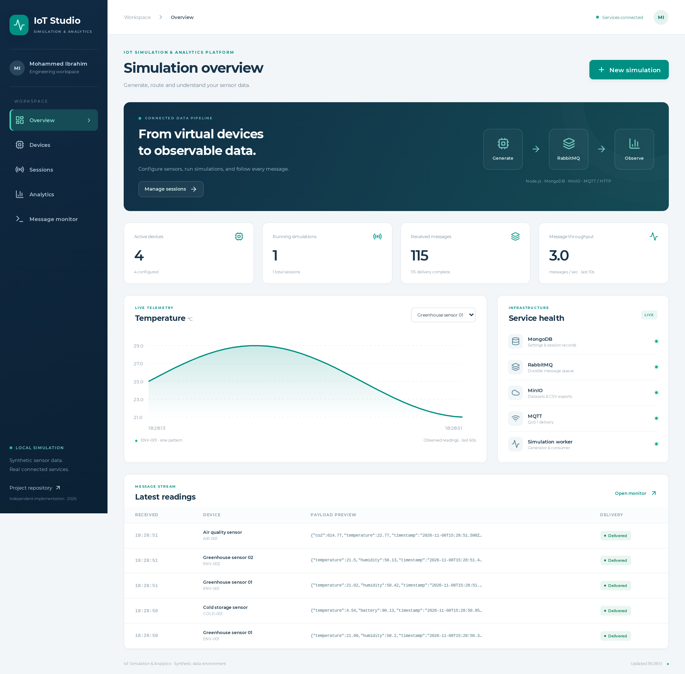

# IoT Simulation & Analytics Platform

A working React + Node.js workspace to configure virtual sensors, generate/replay readings, control sessions, inspect live charts and export CSV. RabbitMQ routes messages, MongoDB retains settings/records, MinIO stores datasets/exports, and consumers deliver through MQTT and HTTP.

**Independent implementation, November 2026, developed with AI coding assistance for Mohammed Basim Ibrahim.** Informed by an academic study of IBA Group IoT Data Simulator. No original student IoT source was recovered. This is not the IBA application and does not claim its code or historical performance results.



## Run locally

Requires Docker Engine + Compose v2 and network access for image/package builds. The first build compiles pinned MinIO source and can take several minutes.

```sh
git clone https://github.com/Mohammed01Ibrahim/iot-simulation-analytics-platform.git
cd iot-simulation-analytics-platform
cp .env.example .env
docker compose up --build -d
docker compose ps
# After API is healthy, optionally seed an empty installation:
docker compose exec api node scripts/seed.js
```

Open **http://localhost:4100**. RabbitMQ management: http://localhost:15672 (`iot` / `local-iot-broker`); MinIO console: http://localhost:9001 (`iotlocal` / `local-development-only`). `.env` overrides documented local development credentials. Host bindings are loopback-only. MongoDB and MinIO S3 stay internal to the Compose network.

Create a device and JSON fields, then create/start a session. Pause/resume/stop controls change scheduling. Analytics filters device, field and time window; Message monitor expands actual envelopes and delivery receipts. Export stores CSV in MinIO and downloads it. CSV replay supports a flat header and up to 5,000 rows.

```sh
docker compose logs -f api worker
# Tests create test records; use a disposable installation.
docker compose --profile test run --build --rm tests
# Stop, preserving data volumes:
docker compose down
```

[Native development instructions](scripts/native-services.md). Browser checks: `npm ci`, `npx playwright install chromium`, `npm run test:e2e` against the running app. Genuine screenshot capture: `node scripts/capture-screenshots.js` after seed/readings. Node 22+ required.

## Observed verification

**9 unit, 10 integration and 2 browser tests passed**, with a successful React production build. Tests use real native MongoDB, RabbitMQ, MQTT, HTTP and MinIO. [Evidence and limits](docs/verification.md) record the environment and exact checks.

**Compose YAML was parsed, but its container build/start was not executed because Docker is unavailable on this host.** Native MinIO needed the documented loopback-discovery patch; Compose builds unmodified upstream source. No scale/latency/production benchmark is claimed.

## Structure

| Directory | Responsibility |
|---|---|
| `web/src/` | React UI, charts, configuration and console |
| `src/domain.js` | Schemas, generation, lifecycle and CSV rules |
| `src/server.js` | REST/SSE, controls, export and UI hosting |
| `src/worker.js` | Leased scheduler, broker consumer and target delivery |
| `src/receiver.js` | Local HTTP receipt verification |
| `deploy/`, `compose.yaml` | Containers and broker configuration |
| `tests/` | Unit, real-service integration and browser tests |
| `docs/screenshots/` | Six genuine PNGs and provenance manifest |
| `docs/diagrams/` | Editable SVG architecture and lifecycle |

[Engineering report](docs/engineering-report.md) · [Requirements/evidence matrix](docs/requirements-evidence.md) · [API](docs/api.md) · [Attribution](docs/third-party.md)

This private repository is for local engineering exploration. Single-worker scheduling, at-least-once delivery, bounded views/exports, no automatic retention and untested failover are explicit limits. It is not a publicly hosted or production-hardened service.
